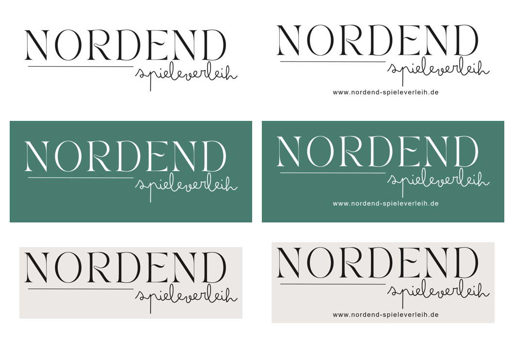

# Logos Nordend-Spieleverleih (Stand 06.11.2026)

Offizielles Logo: NORDEND mit Linie und Schriftzug „spieleverleih“ (Schriften getrennt). Quelle: Canva-Entwurf von Sebastian (`original_canva.png`, 2000 × 750 px, Cremehintergrund).

| Datei | Wofür |
|---|---|
| `nordend-spieleverleih_schwarz-transparent.png` | Standard: auf hellem Hintergrund (Webseite, Signatur, Dokumente) |
| `nordend-spieleverleih_weiss-transparent.png` | auf dunklem Hintergrund oder Fotos (z. B. Nordend-Grün #477c6e) |
| `nordend-spieleverleih_creme.png` | mit Cremehintergrund #ebe8e4, z. B. Social Media |
| `nordend-spieleverleih_mit-webadresse_schwarz-transparent.png` | mit Zeile www.nordend-spieleverleih.de, für Druck/Flyer/Aufkleber |
| `nordend-spieleverleih_mit-webadresse_weiss-transparent.png` | dasselbe für dunkle Hintergründe |
| `nordend-spieleverleih_mit-webadresse_creme.png` | dasselbe mit Cremehintergrund |
| `original_canva.png` | unverändertes Original |

Alle Varianten: ca. 1800 px breit, PNG. Die freigestellten Dateien haben einen echten transparenten Hintergrund.

Direktlinks (z. B. für WordPress oder E-Mail): `https://raw.githubusercontent.com/Nordend-Spieleverleih/shop-bilder/main/logo/<dateiname>`

Hausfarben: Grün #477c6e (Hover #385f55), Text #2b2b2b / #333333, Creme #f5f1ea, Schrift Nunito.

Die E-Mail-Signatur nutzt eine kleinere Kopie unter `signatur/logo.png`.

## Webseite
Seit 06.11.2026 ist `nordend-spieleverleih_schwarz-transparent.png` das Website-Logo (WordPress-Mediathek ID 1806, Einstellung `site_logo`). Das alte Logo (ID 29, Schriften berühren sich) liegt noch in der Mediathek; zurück: Design > Customizer > Website-Informationen oder site_logo wieder auf 29 setzen.
